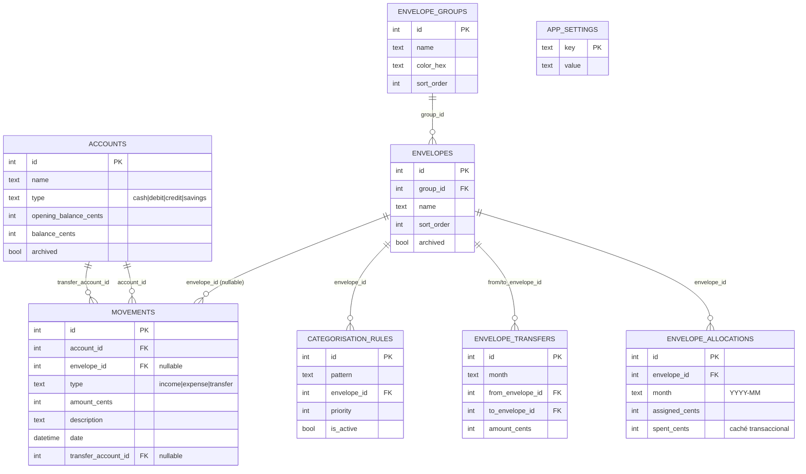

# KipuBudget

Gestor de presupuesto por sobres, **offline-first**, hecho con Flutter + Drift (SQLite).
Todo vive en el dispositivo: sin cuentas, sin servidores, sin conexión obligatoria.

> Un *kipu* era el nudo de cuerda con el que se registraban cuentas en los Andes.
> Cada sobre es un nudo; cada mes, una cuerda nueva.

## Funcionalidades

| Regla | Implementación |
| --- | --- |
| **RF-01 · Base cero** | «Por asignar» = ingresos − asignaciones de todos los sobres. Cada ingreso debe tener destino. |
| **RF-02 · Gasto atómico** | Movimiento + saldo de cuenta + gasto del sobre se escriben en una sola transacción SQLite. Si algo falla, rollback total. |
| **RF-03 · Sobregiro** | El sobre queda en negativo y se resalta en coral. Se cubre moviendo dinero desde otro sobre o asignando más. |
| **RF-04 · Reglas** | Si la descripción contiene una palabra clave, el sobre se sugiere y se selecciona automáticamente al registrar el gasto. |
| **RF-05 · Reportes** | PDF mensual y Excel multi-hoja (resumen, sobres, movimientos), con vista previa y compartir. |
| **RNF · Offline** | SQLite local, índices `(date, envelope_id)` y `(account_id)`, montos en centavos enteros. |

Además: bloqueo biométrico con credencial del dispositivo como respaldo, respaldo/restauración local, tema claro/oscuro Material 3, gráficas de flujo de caja y vista previa del PDF y del Excel antes de compartirlos.

## Stack

- Flutter 3.41 · Dart 3.11
- Riverpod 3 (providers manuales, sin codegen)
- Drift 2.34 sobre SQLite nativo
- fl_chart, pdf + printing, excel + archive, share_plus, local_auth, file_picker

## Arquitectura: monolito modular

```
lib/
├── app/                  # composición: providers, shell, tema, páginas globales
├── core/                 # dinero, fechas, errores, widgets compartidos
├── modules/
│   ├── core_db/          # AppDatabase + tablas Drift (único dueño del esquema)
│   ├── accounts/         # domain: AccountsRepository · data: Drift impl.
│   ├── envelopes/        # domain: EnvelopesRepository · data + UI de sobres
│   ├── transactions/     # domain: TransactionsRepository · data + UI de movimientos
│   ├── reports/          # domain: ReportsRepository · data: consultas + PDF/Excel
│   └── security/         # biometría + respaldo/restauración
└── main.dart
```

Regla de dependencia:

1. La UI consume **solo** interfaces `domain/` vía Riverpod.
2. Cada módulo implementa su interfaz en `data/` contra la base compartida.
3. `core_db` no conoce módulos; los módulos no abren conexiones propias.
4. `reports` puede leer tablas ajenas en modo lectura; nunca escribe.
5. `app/providers.dart` es el único punto que conoce todas las implementaciones.

Esto deja un monolito fácil de testear y de partir en paquetes si algún día crece.

## Modelo de datos



Índices: `idx_movements_date_envelope (date, envelope_id)`, `idx_movements_account (account_id)`, `idx_rules_active_priority (is_active, priority)`, `idx_accounts_archived (archived)`, único `(envelope_id, month)`.

## Decisiones

Las decisiones con contexto completo viven en [`docs/adr/`](docs/adr/):

- [ADR-0001 · Monolito modular](docs/adr/0001-modular-monolith.md)
- [ADR-0002 · SQLite local con Drift](docs/adr/0002-drift-sqlite.md)
- [ADR-0003 · Dinero en centavos enteros](docs/adr/0003-integer-cents.md)
- [ADR-0004 · Gasto atómico y `spent_cents` cacheado](docs/adr/0004-atomic-expense.md)
- [ADR-0005 · Respaldo con `VACUUM INTO` y restauración por ATTACH](docs/adr/0005-backup-restore.md)
- [ADR-0006 · Reportes PDF y Excel en el dispositivo](docs/adr/0006-report-exports.md)

Vocabulario del dominio: [`GLOSSARY.md`](GLOSSARY.md).

## Puesta en marcha

```bash
flutter pub get
dart run build_runner build --delete-conflicting-outputs   # regenera Drift
flutter run -d windows                                     # o android / ios
```

Requisitos: Flutter 3.41+, toolchain de la plataforma elegida. La base se crea sola en el directorio de soporte de la app; en el primer arranque se siembran cuentas y sobres de ejemplo.

## Calidad

```bash
dart format --output=none --set-exit-if-changed lib test
flutter analyze --fatal-infos
flutter test --coverage
```

- Tests de reglas RF-01…RF-04 sobre `NativeDatabase.memory()`.
- Test de atomicidad real: un trigger provoca el fallo a mitad del gasto y se comprueba el rollback.
- Tests de esquema: FKs activas, índices y restricción única `(sobre, mes)`.
- Tests de reportes: bytes PDF (`%PDF`) y Excel decodificado con `Excel.decodeBytes`, incluido autofiltro.
- Test de respaldo/restauración y rechazo de archivos ajenos.
- Smoke test del shell con las cuatro pestañas.
- Gate biométrico: bloquea la app, desbloquea tras verificar, reintenta y falla cerrado si el ajuste no se puede leer.
- Build Android de depuración compilado con Flutter 3.41.9 (`flutter build apk --debug`).

CI (GitHub Actions) corre formato, análisis fatal y la suite completa en cada push a `main`/`develop` y en pull requests.

## Privacidad

Sin telemetría, sin red, sin cuentas. El respaldo es un `.sqlite` que solo tú decides compartir.
El bloqueo biométrico usa el almacén seguro del sistema (`local_auth`) y se activa tras una verificación correcta. Acepta huella, rostro o la credencial del dispositivo, de modo que restablecer la biometría no te deja fuera de tus propios datos.
